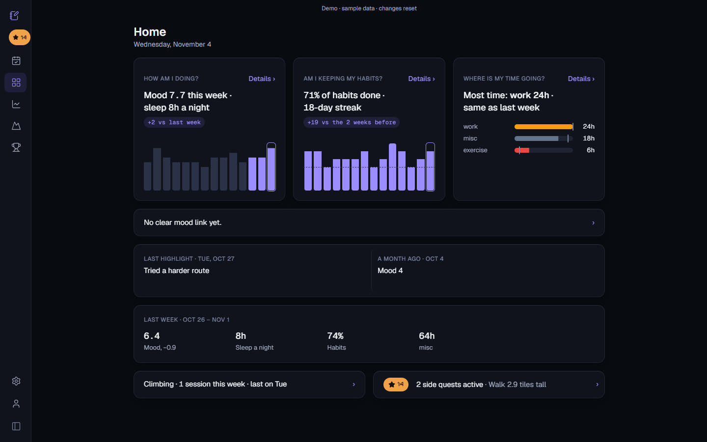
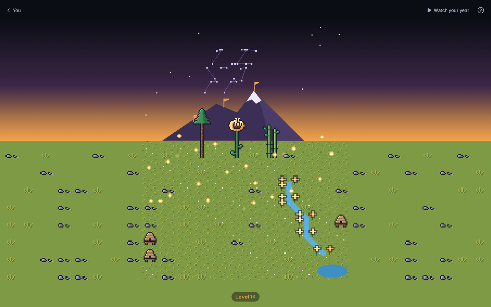
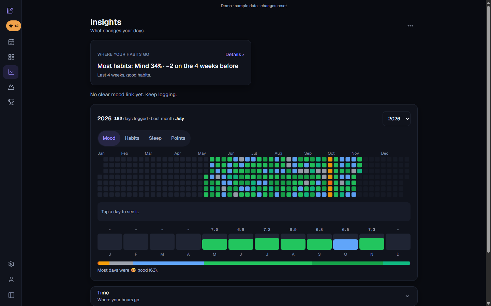
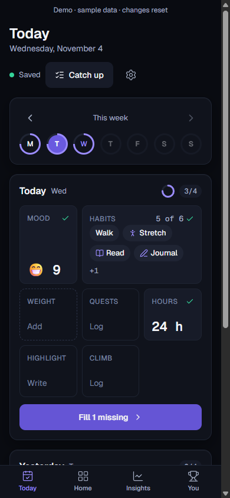

# Journaling App

Log your day in a few taps, then watch it add up: a small pixel valley grows from your logs, and your data stays in your own Google Sheet.

**Live demo:** <DEMO_URL>

## Screenshots

**Home:** your week at a glance: mood, habits and where your time goes.



**The Valley:** a pixel world that grows from your habits.



**Insights:** mood trends, habit rates and mood links.



**On your phone:** log today in a few taps.

<p align="center"></p>

## Features

- **Fast daily log:** mood, habits, weight, hours by category and one daily highlight.
- **The Valley:** a pixel world that grows from your habits. This week's mood sets the sky. "Watch your year" plays a timelapse.
- **Insights:** mood trends, habit rates and mood links (for example "On days when Gym is done, mood is 1.2 higher").
- **Streaks and levels:** points, levels and your best current streak.
- **Climbing:** log sessions and routes, and track a yearly grade goal.
- **Side quests:** yearly goals with a count ("Read 12 books") or milestones.
- **Android widget:** log from your home screen through a key-protected device API.

## How it works

- **Web app:** Next.js 16, React 19, Tailwind 4, Recharts.
- **Sign-in:** next-auth v5 with Google.
- **Storage:** Google Sheets API through a service account. You share your own sheet with it, and the app creates every tab it needs.
- **Row-wise storage:** one row per event, so a sheet never needs 365+ columns.
- **One owner per sheet:** the first account that connects a sheet owns it (`ownerEmail` in the Settings tab).
- **Tooling:** npm workspaces monorepo, tests with `node --test`.

## Layout

| Folder | What it is |
|---|---|
| `apps/web` | The Journal app: Next.js 16, React 19, Tailwind 4, Recharts |
| `apps/widget` | Android home-screen widget: Expo + react-native-android-widget |
| `packages/core` | Pure logic shared by the apps, and the device API contract ([API.md](packages/core/API.md)) |
| `packages/sheets` | Google Sheets layer: client, tab cache, locks, reads and writes |
| `packages/design` | Design tokens: colours, radii, easing. Generates the web app's CSS variables |

Run `npm run dev`, `npm test`, `npm run lint` and `npm run build` from the repo root. You need Node 22 or newer.

## Run locally

### Option A: demo mode (no Google needed)

1. Create `apps/web/.env.local` with:

   ```
   DEMO_MODE=1
   AUTH_SECRET=<any long random string>
   AUTH_TRUST_HOST=true
   ```

2. From the repo root:

   ```
   npm install
   npm run build
   npm start -w @journaling/web
   ```

   Or run `npm run dev` instead of build + start.
3. Open http://localhost:3000. The demo opens on its own.

Notes:
- `DEMO_MODE` must be set at build time and at run time (pages are prerendered).
- Each visitor gets a private, in-memory sandbox with about half a year of made-up sample data.
- A sandbox resets after 2 hours idle, or when the server restarts.

### Option B: full setup with Google

1. Google Cloud: create a service account with the Google Sheets API on, and make a JSON key.
2. Google Cloud: create an OAuth client (web) for sign-in. Redirect URI: `http://localhost:3000/api/auth/callback/google` (and your Vercel URL).
3. In `apps/web`, copy `.env.example` to `.env.local` and fill in:
   - `GOOGLE_SERVICE_ACCOUNT_EMAIL` and `NEXT_PUBLIC_SERVICE_ACCOUNT_EMAIL`: the service account's email (the second is shown on the setup page)
   - `GOOGLE_SERVICE_ACCOUNT_PRIVATE_KEY`: the key's `private_key` (use `\n` for newlines)
   - `GOOGLE_CLIENT_ID`, `GOOGLE_CLIENT_SECRET`: the OAuth client
   - `AUTH_SECRET`: any long random string (sign-in cookies)
   - `ALLOWED_EMAILS`: who may sign in, comma separated. Empty means nobody.
   - `NEXT_PUBLIC_APP_TIME_ZONE` (optional): where your day starts and ends, as an IANA name such as `Europe/Paris`. Default is UTC. Set it before you build.
4. From the repo root:

   ```
   npm install
   npm run dev
   ```

   Then open http://localhost:3000
5. Sign in, make an empty Google Sheet, share it with the service account email as Editor, and paste its link on the setup page. The app creates every tab it needs.

## Evening reminder (optional)

A push at 17:00 UTC (`vercel.json` cron) when today still has items to fill.

1. Make a key pair:

   ```
   npx web-push generate-vapid-keys
   ```

2. Add to `apps/web/.env.local` and to Vercel:
   - `NEXT_PUBLIC_VAPID_PUBLIC_KEY`: the public key
   - `VAPID_PRIVATE_KEY`: the private key (never share it)
   - `VAPID_SUBJECT`: `mailto:` plus your email
   - `CRON_SECRET`: any long random string (Vercel sends it to the cron)
   - `REMINDER_SHEET_IDS`: the sheet ids to remind, comma separated
3. Restart `npm run dev`, then Settings → Reminder → turn it on.

## Devices

The phone widget and other devices save through one key-protected door. Make a code in Settings → Devices. See [API.md](packages/core/API.md).

## Android widget

Needs Android Studio, with `ANDROID_HOME` and `JAVA_HOME` set. On Windows the C++ step hits the 260-character path limit in a deep folder, so also set `WIDGET_CXX_DIR` to a short folder such as `C:/jwcxx`.

1. In `apps/widget`:

   ```
   npx expo prebuild --platform android --no-install
   ```

2. In `apps/widget/android`:

   ```
   gradlew app:assembleRelease -PreactNativeArchitectures=arm64-v8a
   adb install -r app/build/outputs/apk/release/app-release.apk
   ```

## Deploy to Vercel

- Add the same env vars in the Vercel project settings (plus the reminder ones if you use it).
- Set Root Directory to `apps/web`, framework Next.js. Default build command is fine.

### Demo deploy

- Use a separate Vercel project.
- Set Root Directory to `apps/web`.
- Env vars: `DEMO_MODE=1` and its own `AUTH_SECRET`. Optional: `NEXT_PUBLIC_APP_TIME_ZONE`.
- Add no Google variables.

## License

MIT. See [LICENSE](LICENSE).
